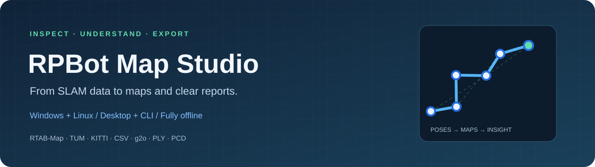
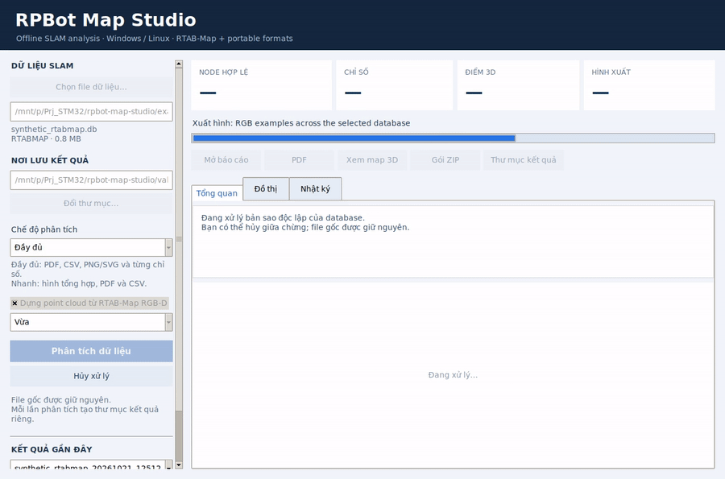
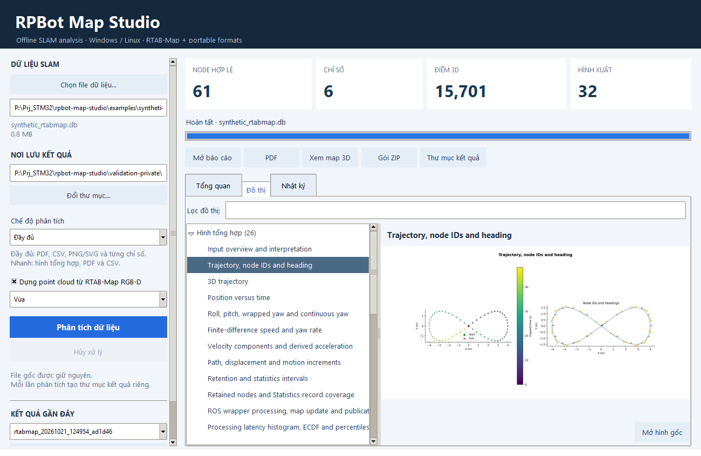
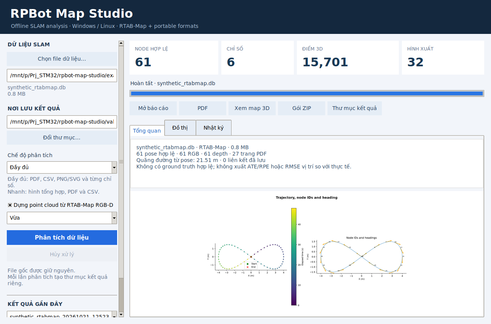
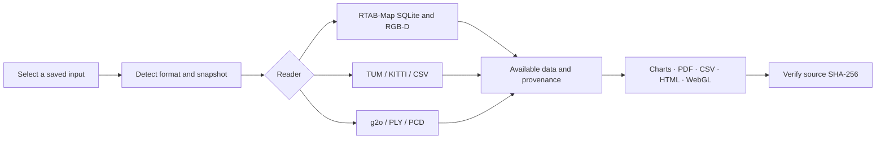

<p align="center"></p>

<p align="center">
  <a href="https://github.com/nguyenbinh-shark/rpbot-map-studio/actions/workflows/ci.yml"></a>
  <a href="https://github.com/nguyenbinh-shark/rpbot-map-studio/releases/latest"></a>
  <a href="LICENSE"></a>
  
</p>

**Open a saved SLAM file. Inspect its trajectory, maps and recorded metrics. Export a report you can share.**

RPBot Map Studio is an offline desktop application and command-line tool for Windows and Linux. It reads compatible **RTAB-Map databases** and common **trajectory, pose-graph and point-cloud exports** from other SLAM workflows. Standalone downloads include Python and the required libraries; ROS, a running robot and internet access are not required.

[Download](https://github.com/nguyenbinh-shark/rpbot-map-studio/releases/latest) · [Quick start](docs/QUICKSTART.md) · [Tiếng Việt](docs/README.vi.md) · [Supported formats](docs/FORMATS.md) · [Validation](docs/VALIDATION.md)

## See it in action

[](https://github.com/nguyenbinh-shark/rpbot-map-studio/releases/download/v2.0.0/RPBotMapStudio-demo.mp4)

**[Watch/download the MP4 demo](https://github.com/nguyenbinh-shark/rpbot-map-studio/releases/download/v2.0.0/RPBotMapStudio-demo.mp4)** · [Short animated preview](docs/media/demo.gif)

The recording shows the actual Linux application loading a sample, running analysis, browsing charts and filtering metrics. It uses the deterministic **synthetic demo data**, not a measured robot experiment. The recording is sampled at 5 frames per second; processing duration varies by hardware and input.

| Browse charts | Run on Linux |
|---|---|
|  |  |

## What you get

- **Trajectory analysis:** XY/3D views, position, orientation, retained-pose path length, sampling intervals and finite-difference motion when timestamps exist.
- **RTAB-Map inspection:** saved pose graph, recorded Statistics, RGB/depth quality proxies and compatible mono RGB-D reconstruction. Extract saved occupancy maps or project stored local grid samples with explicit provenance.
- **Portable formats:** TUM, KITTI, explicit-column CSV, g2o SE2/SE3 pose graphs, PLY and uncompressed PCD clouds.
- **Offline reports:** searchable HTML gallery, multipage PDF, PNG, SVG in Full mode, CSV and a ZIP report bundle. Interactive WebGL point-cloud viewer opens locally in your browser.
- **Source preservation:** analyze independent snapshots; record SHA-256 evidence; check that input files stayed unchanged. Each run gets its own output folder.
- **Desktop and CLI:** file picker, progress, cancellation, chart previews, report history and headless batch use.

The number of figures depends on the fields present in your input. Missing depth, metrics or timestamps are reported rather than fabricated.

## Supported inputs

| Input | Analysis | Important boundary |
|---|---|---|
| RTAB-Map SQLite `.db`, `.sqlite` | Poses, links, Statistics, RGB-D, saved/local occupancy data | Compatible schema required; native datasets validated with RTAB-Map 0.23.13 |
| TUM `.tum`, eight-column `.txt` | Timestamped trajectory and motion | `timestamp tx ty tz qx qy qz qw`; seconds, metres |
| KITTI `.kitti`, twelve-column `.txt` | Trajectory and orientation | Row-major 3×4 matrices; no timestamps or speed inferred |
| CSV `.csv` | Explicit position/orientation, optional timestamps | Named columns; see [schema](docs/FORMATS.md#csv) |
| g2o `.g2o` | SE2 / SE3:QUAT graph and internal consistency | No temporal order or loop-closure label inferred from IDs |
| PLY `.ply` | Point-cloud views, bounds, distributions, WebGL | ASCII/binary vertices; optional RGB |
| PCD `.pcd` | Point-cloud views, bounds, distributions, WebGL | ASCII/uncompressed binary scalar fields; optional RGB |

**Native Cartographer `.pbstream`, ORB-SLAM `.osa`, ROS bag/rosbag2 and proprietary databases are not directly supported.** Export TUM/KITTI trajectories or PLY/PCD clouds from those tools first. An export contains only the data it carries: a trajectory cannot reconstruct the original RGB-D frames or private SLAM statistics.

## Download and run

Get an archive for your OS from **[Releases](https://github.com/nguyenbinh-shark/rpbot-map-studio/releases/latest)**.

**Windows x64:** extract the ZIP and launch `RPBotMapStudio.exe`.

**Linux x86_64:** extract the archive, make the binary executable and launch it from a graphical desktop:

```bash
chmod +x RPBotMapStudio
./RPBotMapStudio
```

Official CI Linux builds target Ubuntu 22.04+ / glibc 2.35+. A display server and standard desktop libraries are needed for the GUI; see [Linux requirements](docs/QUICKSTART.md#linux). ARM64/Raspberry Pi binaries and macOS releases are not provided.

Choose an input → choose an output folder → select **Quick** or **Full** → **Analyze**. The current UI is Vietnamese; chart labels are English. An illustrated Vietnamese guide is included.

Try your first run with **[the synthetic demo bundle](https://github.com/nguyenbinh-shark/rpbot-map-studio/releases/download/v2.0.0/RPBotMapStudio-demo-data.zip)**. Or generate it from source:

```bash
python tools/generate_demo.py
```

## Command line

```bash
# Linux standalone binary; no display required
./RPBotMapStudio --analyze run.tum --output ./reports --mode full

# Source checkout; works on Windows and Linux
python main.py --analyze recording.db --output ./reports --mode quick --no-cloud
python main.py --analyze room.ply --output ./reports
```

Successful analysis returns exit code `0`; failures return `1`. The CLI creates a new run folder under `--output`. Inspect its `progress.json`, `manifest.json` and `source_manifest.json`. The Windows GUI executable does not attach to a console; use the saved reports/status files or run the Python entry point for terminal output.

## Build from source

Python **3.11 or 3.12**, Tk and GCC are required to build. Linux example:

```bash
sudo apt-get install python3-venv python3-tk gcc
python3 -m venv .venv
source .venv/bin/activate
python -m pip install -r requirements-dev.txt
python build_tools.py
python main.py

python -m unittest discover -s tests -v
python -m PyInstaller --noconfirm RPBotMapStudio.spec
```

On Windows, activate `.venv\Scripts\Activate.ps1` and put an x64 GCC compiler (for example MSYS2 UCRT64) on `PATH`. Build on each target OS: Windows DLL/EXE files cannot be reused as Linux shared objects/binaries. [Build and release details](docs/DEVELOPMENT.md).

## How it works



This is a saved-data inspection tool. It does not run SLAM, discover new loop closures or perform pose-graph optimization. Internal graph consistency and stored covariance are not ground-truth accuracy. ATE/RPE requires an explicit ground-truth evaluation workflow and is not calculated here. Projected local occupancy grids are not validated navigation maps.

## Contribute

New readers are welcome. Keep format detection separate from decoding, preserve coordinate conventions, add tests for malformed input and document which quantities are actually available. Start with [CONTRIBUTING](CONTRIBUTING.md) and the [reader contract](docs/DEVELOPMENT.md#reader-contract).

Bug reports: include OS, app version, input format and the relevant error from the run folder. Use a minimal synthetic/reduced example rather than uploading a private map. See [security reporting](SECURITY.md).

## License and acknowledgments

Project source is [MIT licensed](LICENSE). Dependencies retain their respective licenses. The native decoder implements the RVL format described by Andrew D. Wilson, *Fast Lossless Depth Image Compression* (2017); RTAB-Map container/calibration formats are documented against upstream sources. See [third-party notes](THIRD_PARTY.md).
