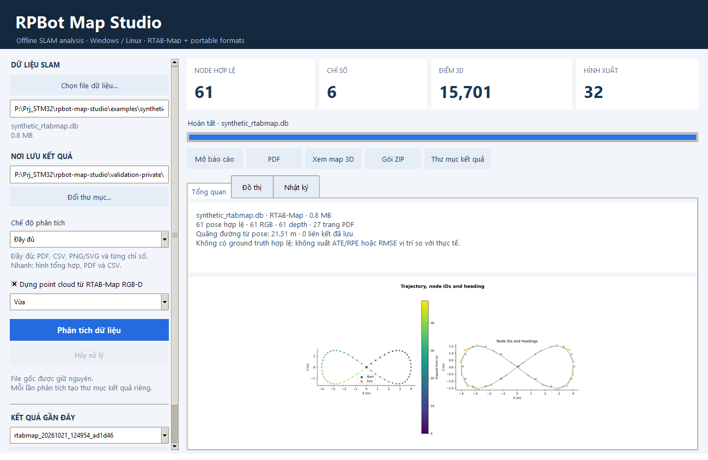

# RPBot Map Studio — hướng dẫn tiếng Việt

App đọc dữ liệu SLAM đã lưu, phân tích quỹ đạo, xem bản đồ và xuất báo cáo trên **Windows/Linux**. Bản đóng gói không cần cài Python, ROS hay WSL; không cần kết nối với robot.

[Tải bản mới nhất](https://github.com/nguyenbinh-shark/rpbot-map-studio/releases/latest) · [Video demo](https://github.com/nguyenbinh-shark/rpbot-map-studio/releases/download/v2.0.0/RPBotMapStudio-demo.mp4) · [English](../README.md)



## Cách dùng

1. Tải đúng bản **Windows x86_64** hoặc **Linux x86_64**, rồi giải nén.
2. Windows: mở `RPBotMapStudio.exe`. Linux: `chmod +x RPBotMapStudio`, sau đó chạy `./RPBotMapStudio` trong môi trường desktop.
3. Bấm **Chọn file dữ liệu…**, chọn file và thư mục kết quả.
4. Chọn **Nhanh** để xuất các hình tổng hợp hoặc **Đầy đủ** để thêm SVG và đồ thị riêng cho từng chỉ số có lưu.
5. Bấm **Phân tích dữ liệu**. Khi xong, xem tab **Tổng quan/Đồ thị**, mở PDF, HTML hoặc bản đồ 3D.

App dùng bản sao độc lập, giữ nguyên file nguồn và ghi checksum SHA-256. Mỗi lần chạy tạo thư mục riêng. Có thể bấm **Hủy xử lý**; thư mục kết quả dở dang vẫn được giữ để kiểm tra.

## File nào đọc được?

| Loại dữ liệu | Khả năng |
|---|---|
| RTAB-Map `.db` tương thích | Pose, liên kết, Statistics, ảnh RGB/depth, bản đồ có lưu; dựng 3D với calibration mono RGB-D phù hợp |
| TUM `.tum`/`.txt` | Quỹ đạo và chuyển động theo timestamp |
| KITTI `.kitti`/`.txt` | Quỹ đạo và góc; không tự đặt timestamp để tính tốc độ |
| CSV | Vị trí/góc theo tên cột rõ ràng, timestamp nếu có |
| g2o SE2/SE3:QUAT | Đồ thị pose và độ nhất quán nội bộ của liên kết |
| PLY/PCD | Đám mây điểm, hình chiếu và viewer 3D; không suy ra quỹ đạo |

**Không phải app đọc mọi database SLAM.** Native Cartographer `.pbstream`, ORB-SLAM `.osa`, ROS bag/rosbag2 chưa được đọc trực tiếp. Cần xuất TUM/KITTI hoặc PLY/PCD từ công cụ gốc trước. Cùng đuôi `.db` hoặc cùng dùng SQLite không có nghĩa là cấu trúc tương thích.

Chi tiết cột CSV, đơn vị và giới hạn ở [FORMATS.md](FORMATS.md). Stereo/multi-camera RTAB-Map hiện phân tích pose/thống kê nhưng không suy đoán calibration để dựng 3D.

## Dữ liệu mẫu và demo

Tải `RPBotMapStudio-demo-data.zip` trong release, mở `synthetic_rtabmap.db` để thử đủ luồng RGB-D. Bộ mẫu và video dùng **dữ liệu mô phỏng tạo riêng**, không phải kết quả đo từ robot và không chứa bản đồ cá nhân.


## Hiểu đúng kết quả

- Đồ thị chỉ được xuất khi file có dữ liệu tương ứng. Không có số lượng hình cố định cho mọi file.
- Quãng đường/tốc độ từ pose là giá trị tính giữa các mẫu được giữ lại; tần suất node không phải FPS camera.
- Residual nội bộ và covariance không phải sai số vị trí so với thực tế. App chưa tính ATE/RPE.
- Nếu RTAB-Map có occupancy grid đã lưu thì app trích nó. Nếu chỉ có local grid thì app chiếu các ô sang 2D và ghi rõ nguồn; chưa xác nhận dùng cho điều hướng robot.
- App không chạy lại SLAM, tối ưu graph hay tìm khép vòng mới.

## Chạy bằng dòng lệnh

```bash
./RPBotMapStudio --analyze run.tum --output ./reports --mode full
python main.py --analyze recording.db --output ./reports --mode quick --no-cloud
```

Linux CLI không cần display. Các hướng dẫn cài đặt, kiểm thử và build nằm ở [QUICKSTART.md](QUICKSTART.md) và [DEVELOPMENT.md](DEVELOPMENT.md).
